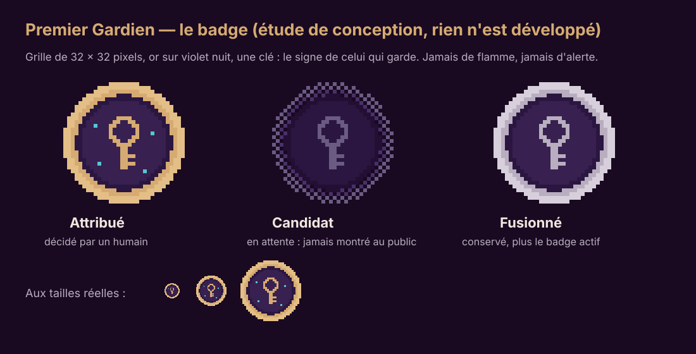
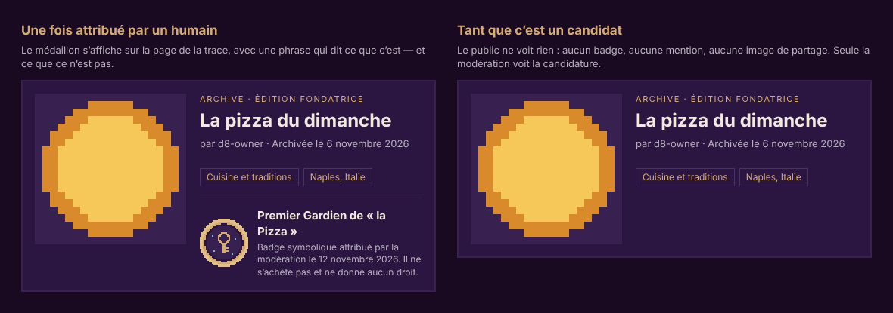

# Badges « Premiers Gardiens » — étude de conception (étape D9)

> **Statut : étude seulement.** Rien n'est développé : **aucune table, aucune migration, aucune route, aucun écran, aucun texte public**. Le site ne parle
> pas de badges aujourd'hui, et il ne doit pas en parler avant que les décisions du §9 soient prises et que les textes aient été vus par un juriste (§10).
> Seul le **visuel** du badge existe (`docs/img/`). Ce document dit ce qu'on construirait, comment, avec quelles garanties, et ce qu'il faut décider avant.



## 1. En bref

Le brief : *« Badges "Premiers Gardiens" (Premier Gardien de la Pizza…). Ne jamais attribuer automatiquement l'unicité d'un sujet à partir des titres ;
prévoir une structure permettant une validation par la modération avant attribution définitive ; préparer le design sans développer toute la complexité. »*

Ce que ce serait : un **badge symbolique et honorifique**, décerné **par un humain de la modération** à l'auteur de la **première trace validée** sur un
**sujet** (« la Pizza », « un message pour 2126 »…), pour une **édition** donnée.

Ce que ce ne serait pas :
- **Pas automatique.** Un titre est un texte libre (« Pizza », « pizza ! », « La pizza du dimanche », « Pizzeria », en anglais, en italien…) : décider que
  deux traces parlent du même sujet, ou que l'une est la première, est un **jugement**. L'outil peut *proposer*, jamais décider.
- **Pas un produit.** Acheter une parcelle n'achète pas un badge ; le prix, la carte et la place ne changent pas ; aucune offre ne s'appuie dessus.
- **Pas un actif.** Ni propriété intellectuelle, ni NFT, ni objet échangeable, ni garantie de quoi que ce soit.

## 2. Ce qui est déjà prêt dans le site

| Besoin du badge | Déjà là | Où |
|---|---|---|
| Savoir de quoi parle une trace | catégorie (liste fermée de 11), lieu associé (texte + pays, jamais de coordonnées) | `parcel_assets.category/place_label/place_country` (D3) |
| Un ordre d'arrivée qu'**on ne peut pas truquer** | la **date d'archivage** = la date de confirmation du paiement par Stripe ; l'utilisateur ne peut pas la modifier, et elle est **affichée** sur la page de la trace | `parcels.activated_at` |
| Une validation humaine tracée | la file de modération, les décisions et le journal | `px_review_asset`, `moderation_actions`, `audit_logs` (append-only) |
| Des rôles | modérateur / administrateur, vérifiés **dans la base** | `admin_roles`, `px_require_staff` |
| Une action « sûre » à confirmer | la saisie du nom pour ouvrir/clore l'édition (le même geste servirait à attribuer) | `/admin/edition` |
| Des pages publiques et des images de partage | la page de trace, l'image de partage en police pixel | `/archive/<code>`, `src/lib/og/brand.tsx` |
| Un « arrêt sur image » de l'archive | le cliché de clôture et l'export | `edition_snapshots`, `archive:export` (D8) |

Il **manque** : les sujets, les candidatures, les attributions, un écran de décision, l'affichage public. C'est l'objet des phases du §11, plus tard.

## 3. Vocabulaire

- **Sujet** : ce dont parle une trace, nommé par la modération, avec un libellé FR et EN (« la Pizza » / "Pizza"), une catégorie, une édition.
- **Candidature** : une trace que la modération a *retenue* comme parlant d'un sujet.
- **Attribution** : la décision de la modération de faire d'une candidature le **Premier Gardien** du sujet.
- **États d'une attribution** : `candidat` → `attribué` ou `refusé` ; un attribué peut être `révoqué` (avec motif) ; un sujet peut être **fusionné** dans un autre
  (le badge le plus ancien reste le seul actif ; l'autre est **conservé** et marqué « fusionné », jamais supprimé en silence).

## 4. Principes (non négociables)

1. **Jamais automatique.** Le code ne décerne rien, même quand une candidature est évidente.
2. **L'outil propose, l'humain décide ; la décision est signée et datée** (qui, quand, pourquoi : une note).
3. **Rien de public avant la décision** : pas de badge, pas de mention, pas d'image de partage pour un candidat (voir la mise en situation, §7).
4. **Un seul Premier Gardien actif par sujet et par édition — garanti par la base** (un index unique partiel), pas seulement par le code de l'application.
5. **Rien ne disparaît en silence** : refus et révocations sont motivés, les fusions conservent l'ancien badge, tout va dans le journal d'audit.
6. **Aucun avantage acheté** : aucun effet sur le prix, la carte, la place, le classement.
7. **Aucune donnée personnelle en plus** : seul le pseudonyme, déjà public, est montré.

## 5. Comment un humain décide (parcours proposé)

1. **La modération valide les créations comme aujourd'hui.** Rien ne change pour les acheteurs : pas un champ de plus à l'achat (le sujet ne se saisit pas).
2. Un écran réservé au personnel, « **Gardiens** » (futur), liste les sujets ouverts, avec « Nouveau sujet » : libellé FR, libellé EN (**les deux obligatoires**), catégorie,
   note interne. Les **marques** et les **noms de personnes** sont **refusés par défaut** ; les insultes et les sujets vagues aussi.
3. Pour un sujet, le modérateur voit des **suggestions** : des traces validées de la même catégorie dont le titre « ressemble » (comparaison approchée, sans accents ni
   majuscules). **Ce ne sont que des suggestions** : il coche celles qui parlent *vraiment* du sujet ; elles deviennent des **candidates**, triées par **date d'archivage**.
4. Il **désigne le premier** : la candidate la plus ancienne **dont la création est validée**. Si une plus ancienne est encore **en attente de modération** ou
   **contestée**, on **attend** : l'écran le dit en toutes lettres, et refuse de continuer.
5. Il écrit une note et **confirme en tapant le libellé du sujet** (même garde-fou que l'ouverture de l'édition) → l'attribution passe à `attribué`.
6. L'auteur voit le badge sur sa trace et dans son compte (« Mes traces ») ; la page de la trace le montre (§7).
7. **Contestation** : le bouton « Signaler » existant, plus une procédure : un administrateur peut **révoquer** avec un motif ; l'historique reste visible du personnel.

**L'ordre d'arrivée** est la **date d'archivage** (paiement confirmé), **pas** la date où l'image a été envoyée ni celle du dernier changement : c'est la seule date que
personne ne peut modifier, et c'est celle que tout le monde **voit** sur la page de la trace — chacun peut donc vérifier « premier » de lui-même.
(Le plan abandonné du « Registre » prenait la plus tardive de « création envoyée » et « parcelle payée » ; dans l'archive la date affichée est celle du paiement : plus simple, plus lisible.)

Cas particuliers (règles proposées) :
- *Même auteur, plusieurs traces sur le sujet* : un seul badge par auteur et par sujet, calculé sur sa trace la plus ancienne.
- *Remboursement, retrait par la modération, compte suspendu* : la trace **perd** sa candidature ; si elle était attribuée, révocation motivée et la candidate suivante est examinée **par un humain**.
- *Compte supprimé* : le badge est **conservé**, affiché « compte supprimé » (l'archive ne s'efface pas, voir `docs/BACKUP_RESTORE.md` et la question juridique de l'effacement).
- *Projet collectif / dessin partagé* : le badge va au **compte auteur de la parcelle** ; les contributeurs n'en reçoivent pas (voir les décisions, §9).
- *Deux modérateurs décident en même temps* : la base **verrouille la ligne du sujet** ; un seul gagne, l'autre voit « déjà attribué ».

## 6. Modèle de données prévu (rien n'est créé)

Esquisse, pour que la structure soit prête quand on la voudra — **aucune migration maintenant**.

```text
badge_subjects   id, edition_id, slug, label_fr, label_en, category (null possible), status (open | closed | merged),
                 merged_into (null), note, created_by, created_at
badge_awards     id, code (public, 10 caractères), subject_id, parcel_id, user_id (l'auteur), edition_id,
                 status (candidate | awarded | refused | revoked), note, decided_by, decided_at, revoked_reason, created_at

index unique   badge_awards (subject_id)            where status = 'awarded'   ← un seul Premier Gardien actif
index unique   badge_awards (subject_id, parcel_id)                              ← pas deux candidatures de la même trace
journal        audit_logs (déjà append-only) : badge.subject_create, badge.candidate, badge.award, badge.refuse, badge.revoke, badge.merge
```

- **Fonctions SQL réservées au personnel** (`px_require_staff`, comme `px_edition_open`) : créer un sujet, ajouter une candidate, attribuer, refuser, révoquer,
  fusionner. L'application **n'écrit jamais** directement dans ces tables ; chaque fonction **verrouille la ligne du sujet** (`for update`) et écrit le journal.
- **RLS** : le public ne lit que les attributions `attribué` dont la trace est visible ; tout le reste (candidates, refus, notes, révocations) est réservé au personnel.
- **Édition et clôture** : la modération garde, après la clôture, le pouvoir de décider (voir la décision n°6). Une attribution postérieure au cliché demande un **nouveau cliché**
  (une révision, comme pour un retrait) ; le manifeste du cliché et l'export (`manifest.json`, `index.html`) porteraient alors le badge de chaque trace.
- **Données** : aucune donnée personnelle nouvelle (le pseudonyme est déjà public).

## 7. Design



- **Le médaillon** : rond, sur une grille de **32 × 32 pixels**, **or `#D6AB72` sur violet `#382050`**, une **clé** (le signe de celui qui garde) et trois ou quatre points cyan
  `#55C7D1`. Pixelisé comme le logo et les boutons ; **jamais** de flamme, d'étoile qui explose, de couronne, de chiffre. Fichiers : `docs/img/badge-premier-gardien.svg`
  (attribué), `badge-candidat.svg`, `badge-fusionne.svg` (vectoriels, `shape-rendering: crispEdges`, nets à toute taille : 24, 48, 96 px et au-delà).
- **Trois états qui se distinguent sans la couleur seule** : *attribué* (anneau plein, or, points cyan) ; *candidat* (anneau **brisé**, violet éteint : pour le personnel seulement) ;
  *fusionné* (anneau argent, conservé).
- **Où il apparaîtrait** : sous le titre et les étiquettes de la page de la trace (`/archive/<code>`), avec une phrase qui dit ce que c'est **et ce que ce n'est pas** ;
  en petit (24 px) à côté du titre sur la fiche de la carte ; dans « Mes traces » du compte ; sur une page publique `/badge/<code>` (le sujet, le pseudonyme, la date
  d'attribution, un lien vers la trace, la mention « badge symbolique ») ; et une **image de partage** (réutilisant `src/lib/og/brand.tsx`) — **jamais pour un candidat**.
- **Pas de classement, pas de compteur public** (« n badges »), pas de numérotation « n° 1 / n » : cela inviterait à jouer le système plutôt qu'à archiver quelque chose de vrai.
- **Accessibilité** : le médaillon est décoratif quand la phrase à côté dit la même chose (`alt=""`), sinon `alt = « Premier Gardien de la Pizza, badge attribué le … »` ; le sens
  ne repose jamais sur la seule couleur ; la phrase s'affiche en texte (ivoire sur nuit, contraste 15,7 : 1).
- **Textes (à valider, FR/EN)** : `Premier Gardien de « {sujet} »` / `First Keeper of “{subject}”` ; `Badge symbolique attribué par la modération le {date}. Il ne s'achète pas et ne donne aucun droit.` / `A symbolic badge awarded by the moderators on {date}. It cannot be bought and gives no rights.` — **Aucun de ces textes n'est dans le site.**

## 8. Risques et réponses

| Risque | Réponse prévue |
|---|---|
| Deux Premiers Gardiens pour le même sujet | verrou de ligne + index unique partiel ; test de concurrence (deux modérateurs, un seul gagne) |
| Une vieille trace « en attente » bloque tout le monde | c'est la règle annoncée à l'écran ; un tableau des candidatures en attente les plus anciennes, et un objectif de délai de modération |
| Variantes d'écriture, langues, fautes de frappe | libellés FR/EN, normalisation (accents, majuscules), **suggestions** seulement ; la décision reste humaine |
| Sujets qui sont des marques, des personnes, des insultes, des concepts vagues | refus par défaut ; liste de refus ; signalement ; contestation |
| Jouer le système (acheter beaucoup de parcelles sur beaucoup de sujets) | un badge par auteur et par sujet ; pas de classement ; la modération voit tout ; aucun avantage matériel |
| Abus d'un modérateur | journal append-only signé ; la révocation demande un motif ; (option : deux personnes pour une révocation) |
| Fusion de deux sujets qui ont chacun un badge | le plus ancien reste actif, l'autre est « fusionné » et conservé, journal et notification |
| Remboursement, retrait, compte supprimé | voir §5 : perte de la candidature / révocation motivée / conservation « compte supprimé » |
| Une image de partage qui annoncerait un badge pas encore décidé | impossible par construction : l'image n'existe que pour un badge `attribué` |

## 9. Décisions à prendre avant tout développement

Chaque question a une **recommandation** ; sans réponse du propriétaire, c'est elle qui s'appliquerait.

1. **Qui crée les sujets ?** — Recommandation : **les modérateurs et administrateurs seulement**. Pas de saisie à l'achat ni par les utilisateurs.
2. **Quel ordre d'arrivée ?** — Recommandation : la **date d'archivage** (paiement confirmé), visible de tous.
3. **Un badge par sujet et par édition, ou un seul pour toujours ?** — Recommandation : **par édition** (aujourd'hui, seule la fondatrice existe).
4. **Plusieurs traces du même auteur sur un sujet** — Recommandation : un seul badge par auteur et par sujet.
5. **Projets collectifs et dessin partagé** — Recommandation : le badge va au **compte auteur de la parcelle** ; pas de badge pour les contributeurs.
6. **Après la clôture, la modération peut-elle encore décerner ?** — Recommandation : **oui pendant 30 jours** (annoncés), puis un cliché final avec les badges ; les révocations pour erreur ou abus restent possibles ensuite.
7. **Marques et noms de personnes** — Recommandation : **refusés par défaut** (une exception se décide, se motive et se journalise).
8. **Le mot** : « Premier Gardien » (celui du brief), « Première Gardienne / Premier Gardien » selon la personne, ou une écriture neutre (« Premier·ère Gardien·ne », « Gardien·ne d'origine ») ? — Recommandation : **« Premier Gardien »** comme *titre* de l'honneur, tel quel dans le brief ; à confirmer.
9. **Visibilité** — Recommandation : sur la trace, la fiche de la carte, le compte et `/badge/<code>` ; **pas de classement, pas de compteur, pas de numéro**.
10. **Langues des sujets** — Recommandation : libellé **FR et EN obligatoires**.
11. **Que dire au public, et quand ?** — Recommandation : **rien** avant que le mécanisme existe et que le juriste ait vu les textes.
12. **Faut-il une notification à l'auteur ?** — Recommandation : oui, dans le compte (la page « nouveautés » existe déjà), pas d'e-mail.

## 10. À faire examiner par un juriste (aucune règle fixée ici)

- La formulation « **badge symbolique et honorifique**, ni propriété intellectuelle, ni NFT, ni actif échangeable, sans valeur marchande », dans les conditions.
- Que « **premier** » soit **vérifiable et contestable** (le critère est la date d'archivage, affichée ; la procédure de contestation est décrite) : à examiner sous l'angle de la
  loyauté envers les consommateurs — le badge ne doit jamais être présenté comme un **argument de vente** ni laisser croire que **le prix achète l'exclusivité**.
- La **décision discrétionnaire** d'une modération (motivée, journalisée, avec une voie de recours) et sa transparence.
- Les **données** : un pseudonyme public attaché à un honneur, l'effacement d'un compte face à un badge conservé, et la présence des badges dans l'export de l'archive.

## 11. Plus tard : un découpage possible (rien n'est lancé)

| Phase | Contenu | Tests à écrire | Taille |
|---|---|---|---|
| **P1** | migration (tables, index uniques, fonctions du personnel, RLS) | base : concurrence (un seul attribué), droits, refus, révocation, fusion, compte supprimé, RLS (le public ne lit que l'attribué visible) | moyenne |
| **P2** | écran du personnel « Gardiens » : sujets, candidates triées, désignation avec confirmation | e2e : parcours complet, attente d'une plus ancienne, double confirmation | moyenne |
| **P3** | affichage public : page de trace, fiche de la carte, `/badge/<code>`, image de partage, textes FR/EN | e2e + axe ; jamais d'image pour un candidat | petite à moyenne |
| **P4** | suggestions de candidates (comparaison approchée) ; badges dans le cliché et l'export | unitaire + base | petite |
| **P5** | « Mes badges », notification dans le compte | e2e | petite |

Pré-requis : les décisions du §9, et le passage des textes chez un juriste **avant P3** (rien de public avant).

## 12. Ce que cette étape n'a pas fait

Aucune table, aucune migration, aucune route, aucun écran, aucun texte public, aucune attribution. Elle livre : ce document, les trois SVG du médaillon, la planche des états et la mise en situation
(`docs/img/`). Le plan abandonné du « Registre de l'humanité » (`PLAN_REGISTRE_DE_L_HUMANITE.md`, rien n'en a été écrit) reste une source de leçons, pas un plan à suivre.
