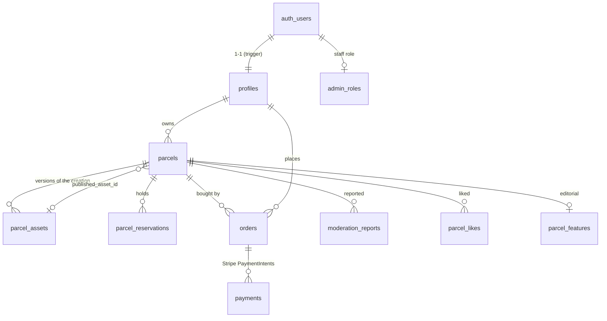

# Database

PostgreSQL (Supabase). Migrations are plain SQL in `supabase/migrations/` and are applied by `supabase db push` or
`node scripts/migrate.mjs`. A tiny Supabase-compatible shim (`tests/db/supabase-shim.sql`) lets the exact same migrations run on
plain PostgreSQL for tests and local development.

## Relations

| Table | Purpose |
|---|---|
| `profiles` | public identity (username, avatar, country, bio), `status` active/suspended. Created by trigger on signup |
| `admin_roles` | `moderator` / `admin`. **Separate table, no client policy**: roles can't be changed from the browser |
| `app_settings` | unit price (cents), min/max area, reservation TTL, holds per user, `sales_open` |
| `parcels` | the territory: integer rectangle, generated `area` and `bbox`, `status` reserved/active/released/revoked, `published_asset_id`, `hidden_at` |
| `parcel_reservations` | the hold on a reserved parcel (`held/converted/expired/canceled`, `expires_at`) |
| `orders` | snapshot of what was bought: rectangle, unit price, `amount_cents = area × unit_price` (CHECK), tax/total/billing as reported by Stripe |
| `payments` | one row per Stripe PaymentIntent (succeeded/failed/refunded/disputed…) |
| `stripe_events` | idempotency ledger: every event id ever received, with status and attempts |
| `parcel_assets` | **versions** of a creation (image path, hash, size, title, description, https link, `is_commercial`, moderation status) |
| `moderation_reports` | user reports with an **evidence snapshot** (what was displayed, hash, texts, link, owner) |
| `moderation_actions`, `audit_logs` | append-only (triggers forbid UPDATE/DELETE) journals of staff and payment events |
| `parcel_likes`, `parcel_features` | popularity (likes in the last 30 days) and editorial selection |
| `rate_limits`, `map_state` | shared rate-limit counters; the map version used to bust caches |

## Overlap protection (the critical invariant)

1. **Integer coordinates + CHECKs**: `x,y ≥ 0`, `x+w ≤ 40 000`, `y+h ≤ 25 000`, `w,h ≥ 1`, sides ≤ 1000, area between 100 and 10⁶.
2. **`bbox`** = generated `box(point(x,y), point(x+w-1, y+h-1))` — the closed integer cell rectangle, so adjacent parcels do **not** overlap.
3. **`EXCLUDE USING gist (bbox WITH &&) WHERE (status IN ('reserved','active'))`** — PostgreSQL enforces, atomically and
   across concurrent connections, that no two live parcels intersect. A second overlapping insert blocks until the first
   commits, then fails with `23P01`.
4. **Reservations are parcels in status `reserved`** (with a `parcel_reservations` row carrying the expiry), so reserved
   and sold pixels are protected by the *same single constraint*: there is no cross-table race.
5. **`px_lock_tiles`**: advisory locks on the 1000×1000 regions touched (always in ascending order) turn the rare
   "two transactions waiting on each other's uncommitted rows" deadlock into an orderly queue.
6. **Expiry**: `px_start_order` releases lapsed holds overlapping the requested area first (so the cron job is hygiene, not
   a correctness dependency); `px_expire_reservations()` sweeps the rest. A paid parcel is `active` and is never released.
7. **Recovery**: `px_fulfill_order` re-activates a lapsed hold if the pixels are still free, otherwise marks the order
   `refund_required` (automatic refund) — it can never double-sell. Refunds/lost disputes set the parcel `revoked`, which frees the pixels.

Tests: `tests/db/overlap.test.ts`, `reservations.test.ts` (40 buyers on the same area → exactly 1 winner; 300 random
overlapping rectangles → no overlapping pair; payment racing a new reservation), `payments.test.ts`, `scale.test.ts`.

## Business functions (all `px_*`, executable by the server role only)

`px_start_order`, `px_cancel_order`, `px_expire_reservations`, `px_extend_reservation`, `px_fulfill_order`,
`px_record_payment_failure`, `px_record_refund`, `px_record_dispute`, `px_add_asset`, `px_review_asset`,
`px_set_parcel_hidden`, `px_set_parcel_featured`, `px_set_user_suspended`, `px_resolve_report`, `px_revoke_parcel`,
`px_set_setting`, `px_audit_staff_refund`, `px_public_stats`, `px_rate_limit`. Staff functions re-check the caller's role in
`admin_roles` themselves and write the audit log **in the same transaction**.

## Row Level Security

RLS is enabled on every table; default grants are revoked and re-granted column by column. The browser (anon key / user JWT)
can only:

| | anon | authenticated | staff |
|---|---|---|---|
| active parcels | read | read; also its own reservations | read all |
| creations | approved ones of visible parcels | + its own versions | all |
| orders, payments, reservations | – | its own (no Stripe ids on payments) | all |
| profiles | public fields | + update own safe fields (not `status`) | read |
| likes | – | its own | – |
| reports | – | its own (no evidence/IP columns) | all |
| `admin_roles`, `stripe_events`, `rate_limits`, writes anywhere | – | – | – |
| `audit_logs`, `moderation_actions` | – | – | read (append-only) |

Server code connects with the table-owner role (bypasses RLS) and is the only writer. `tests/db/permissions.test.ts` checks the matrix.

## Backup and restore

See [`BACKUP_RESTORE.md`](BACKUP_RESTORE.md).
