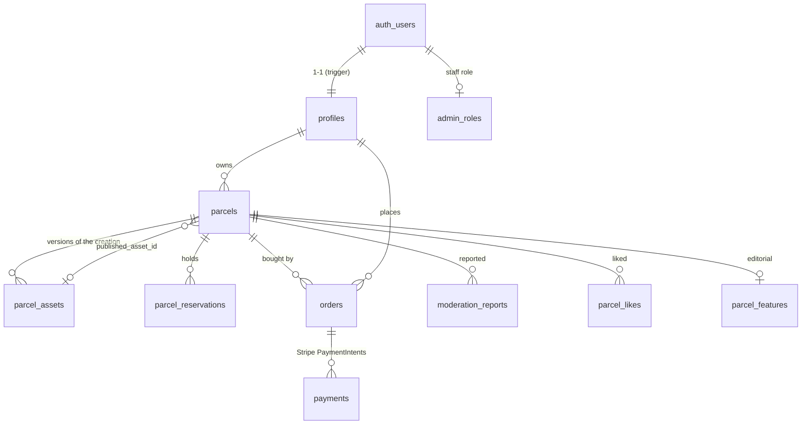

# Database

PostgreSQL (Supabase). Migrations are plain SQL in `supabase/migrations/` and are applied by `supabase db push` or
`node scripts/migrate.mjs`. A tiny Supabase-compatible shim (`tests/db/supabase-shim.sql`) lets the exact same migrations run on
plain PostgreSQL for tests and local development.

## Relations

| Table | Purpose |
|---|---|
| `profiles` | public identity (username, avatar, country, bio), `status` active/suspended. Created by trigger on signup |
| `admin_roles` | `moderator` / `admin`. **Separate table, no client policy**: roles can't be changed from the browser |
| `app_settings` | unit price (cents), min/max area, reservation TTL, holds per user, `sales_open` |
| `parcels` | the territory: integer rectangle, generated `area` and `bbox`, `status` reserved/active/released/revoked, `published_asset_id`, `hidden_at` |
| `parcel_reservations` | the hold on a reserved parcel (`held/converted/expired/canceled`, `expires_at`) |
| `orders` | snapshot of what was bought: rectangle, unit price, `amount_cents = area × unit_price` (CHECK), tax/total/billing as reported by Stripe |
| `payments` | one row per Stripe PaymentIntent (succeeded/failed/refunded/disputed…) |
| `stripe_events` | idempotency ledger: every event id ever received, with status and attempts |
| `parcel_assets` | **versions** of a creation (image path, hash, size, title, description, https link, `is_commercial`, moderation status) |
| `moderation_reports` | user reports with an **evidence snapshot** (what was displayed, hash, texts, link, owner) |
| `moderation_actions`, `audit_logs` | append-only (triggers forbid UPDATE/DELETE) journals of staff and payment events |
| `parcel_likes`, `parcel_features` | popularity (likes in the last 30 days) and editorial selection |
| `parcel_comments` | comments under a parcel (server-only; removed ones are kept, marked) |
| `rate_limits`, `map_state` | shared rate-limit counters; the map version used to bust caches |

## Overlap protection (the critical invariant)

1. **Integer coordinates + CHECKs**: `x,y ≥ 0`, `x+w ≤ 40 000`, `y+h ≤ 25 000`, `w,h ≥ 1`, sides ≤ 1000, area between 25 and 10⁶.
2. **`bbox`** = generated `box(point(x,y), point(x+w-1, y+h-1))` — the closed integer cell rectangle, so adjacent parcels do **not** overlap.
3. **`EXCLUDE USING gist (bbox WITH &&) WHERE (status IN ('reserved','active'))`** — PostgreSQL enforces, atomically and
   across concurrent connections, that no two live parcels intersect. A second overlapping insert blocks until the first
   commits, then fails with `23P01`.
4. **Reservations are parcels in status `reserved`** (with a `parcel_reservations` row carrying the expiry), so reserved
   and sold pixels are protected by the *same single constraint*: there is no cross-table race.
5. **`px_lock_tiles`**: advisory locks on the 1000×1000 regions touched (always in ascending order) turn the rare
   "two transactions waiting on each other's uncommitted rows" deadlock into an orderly queue.
6. **Expiry**: `px_start_order` releases lapsed holds overlapping the requested area first (so the cron job is hygiene, not
   a correctness dependency); `px_expire_reservations()` sweeps the rest. A paid parcel is `active` and is never released.
7. **Recovery**: `px_fulfill_order` re-activates a lapsed hold if the pixels are still free, otherwise marks the order
   `refund_required` (automatic refund) — it can never double-sell. Refunds/lost disputes set the parcel `revoked`, which frees the pixels.

Tests: `tests/db/overlap.test.ts`, `reservations.test.ts` (40 buyers on the same area → exactly 1 winner; 300 random
overlapping rectangles → no overlapping pair; payment racing a new reservation), `payments.test.ts`, `scale.test.ts`.

## Business functions (all `px_*`, executable by the server role only)

`px_start_order`, `px_cancel_order`, `px_expire_reservations`, `px_extend_reservation`, `px_fulfill_order`,
`px_record_payment_failure`, `px_record_refund`, `px_record_dispute`, `px_add_asset`, `px_review_asset`,
`px_set_parcel_hidden`, `px_set_parcel_featured`, `px_set_user_suspended`, `px_resolve_report`, `px_revoke_parcel`,
`px_set_setting`, `px_audit_staff_refund`, `px_public_stats`, `px_rate_limit`. Staff functions re-check the caller's role in
`admin_roles` themselves and write the audit log **in the same transaction**.

## Row Level Security

RLS is enabled on every table; default grants are revoked and re-granted column by column. The browser (anon key / user JWT)
can only:

| | anon | authenticated | staff |
|---|---|---|---|
| active parcels | read | read; also its own reservations | read all |
| creations | approved ones of visible parcels | + its own versions | all |
| orders, payments, reservations | – | its own (no Stripe ids on payments) | all |
| profiles | public fields | + update own safe fields (not `status`) | read |
| likes | – | its own | – |
| reports | – | its own (no evidence/IP columns) | all |
| `admin_roles`, `stripe_events`, `rate_limits`, writes anywhere | – | – | – |
| `audit_logs`, `moderation_actions` | – | – | read (append-only) |

Server code connects with the table-owner role (bypasses RLS) and is the only writer. `tests/db/permissions.test.ts` checks the matrix.

## Backup and restore

See [`BACKUP_RESTORE.md`](BACKUP_RESTORE.md).

## Coastal parcels (migration 6)

`parcels.land_px` (NULL = all land) and `orders.land_px` / `orders.sea_percent` record how many pixels of a parcel are land and which sea price applied. `px_start_order(user, x, y, w, h, p_land default null)` takes the land count from the application server, checks `1 ≤ p_land ≤ area` and `p_land × 100 ≥ area × min_land_percent`, and prices the order as `land × unit + ⌊sea × unit × sea_percent / 100⌋`; the `orders_amount_consistent` check re-derives that from the row. Settings `sea_price_percent` (0–100, default 0) and `min_land_percent` (1–100, default 50) go through `px_set_setting` (admins only). `px_public_stats().sold_pixels` sums `coalesce(land_px, area)`.

## Water parcels (migration 15)

`parcels.kind` / `orders.kind` (`land` | `water`), `orders.water_percent`, and `parcels.owned_px` (generated: `w*h - land_px` for water, `coalesce(land_px, w*h)` for land). The single `parcels_no_overlap` exclusion constraint is replaced by `parcels_no_overlap_land` and `parcels_no_overlap_water` (partial, on `status in ('reserved','active')`): parcels of different kinds may share a rectangle, never a pixel. A water parcel must carry a land count (`parcels_water_has_land_count`). `px_start_order(user, x, y, w, h, p_land, p_currency, p_kind default 'land')` (the old 7-argument signature is dropped) takes the number of LAND pixels of the rectangle from the application server and checks `owned × 100 ≥ area × min_*_percent` for the kind (`px_not_on_land` / `px_not_on_water`); `px_is_area_free(x, y, w, h, kind default 'land')`; `px_public_stats()` returns `sold_pixels` (the sum of `owned_px`: the whole planet), `water_pixels`, `water_parcels`. New settings: `water_price_percent`, `min_water_percent`, `land_cut_price_percent` (`px_set_setting` validates them).

## Tenth-of-a-pixel drawing (migration 11)

`px_dot_scale(w, h)` = the largest `k ≤ 10` with `k² · w · h ≤ 4 000 000`. `px_add_asset` accepts an image of `k' · w × k' · h` for any whole `1 ≤ k' ≤ px_dot_scale(w, h)` (otherwise `px_bad_dimensions`); `px_collab_paint` bounds the overlay to `k · w × k · h` dots; overlays drawn at 2 dots per pixel are re-expressed at the parcel's scale (each old dot becomes the dots it covered; `reset_version` moves so connected pages reload). Prices, `area`, `land_px` and `px_public_stats()` are untouched (`tests/db/half-pixel.test.ts`, which also checks that SQL and application agree on the rule).

## Half-pixel drawing (migration 10)

`px_add_asset` now accepts an image of `w × h` or `2w × 2h` (anything else raises `px_bad_dimensions`); `px_collab_paint` bounds the overlay to `2w × 2h` dots; overlays drawn before the migration are expanded to their 2 × 2 dots and `reset_version` is moved so connected pages reload. Prices, `area`, `land_px` and `px_public_stats()` are untouched: a parcel is still `w × h` pixels (`tests/db/half-pixel.test.ts`).

## Drawing together (migration 9)

`parcel_collab` (one row per shared parcel: secret `token` of 40 hex characters, `enabled`, a `version` counter, `reset_version`) and `parcel_collab_pixels` (`parcel_id, x, y, rgb, version`; x/y in dots, relative to the parcel). Both are server-only (RLS on, nothing granted to `anon`/`authenticated`). `px_collab_enable(user, parcel, rotate)`, `px_collab_disable`, `px_collab_reset` are owner-only and journalled; `px_collab_paint(token, xs[], ys[], rgb[])` is the one write open to the holder of a token: all-or-nothing, ≤ 2 000 pixels, bounds-checked, last write wins, and serialised per parcel by a row lock so that versions follow commit order (`tests/db/collab.test.ts`, including 40 concurrent writers).

## Editions (migration 19)

`editions` (one row today, the founding edition: `slug`, `name`, `status` `prelaunch` / `open` / `closed`, `duration_days` (100), `opens_at`, `closes_at`, `closed_at`; a check keeps the dates consistent with the status — **pre-launch has no date at all**; a unique index allows one edition for now), `edition_snapshots` (append-only: `revision`, `parcel_count`, `manifest_hash` (sha256 of the manifest text), `manifest` jsonb) and `parcels.edition_id` (filled by a trigger). Both tables: row-level security on, nothing granted to the browser roles. Functions (server role only): `px_edition_state`, `px_edition_is_frozen`, `px_assert_edition_open`, `px_assert_edition_editable`, `px_edition_info`, `px_edition_open`, `px_edition_close_now`, `px_edition_extend`, `px_edition_reset`, `px_edition_end_campaigns`, `px_edition_build_snapshot`, `px_edition_take_snapshot`, `px_edition_sweep`. Eleven existing functions got one guard line each (`px_start_order`, `px_create_campaign`, `px_start_contribution`, `px_review_campaign` (approval), `px_add_asset`, `px_collab_paint/reset/enable`, `px_comment_add`) or a refund branch (`px_fulfill_order`, `px_fulfill_contribution`); `parcel_likes` has a guard trigger. See `ARCHITECTURE.md` §3f.

## Archive fields (migration 20)

`parcel_assets` and `campaigns` gain `category` (one of eleven codes, check constraint), `place_label` (1–80 characters) and `place_country` (two upper-case letters); all nullable (every earlier creation has none), **no coordinates**. `px_clean_archive` holds the rules (`px_invalid_archive`), `px_set_asset_archive` (the author, a pending version, not frozen) and `px_set_campaign_archive` (the creator, a pending project) write them, and `px_review_campaign` copies a project's fields onto its creation. See `ARCHITECTURE.md` §3g.

## Snapshot manifest (migration 21)

`px_edition_manifest()` (read-only, `revoke`d from `anon`/`authenticated`) answers the manifest of what the public can see right now: a `jsonb` array, one item per active, visible parcel of an active author, ordered by code; each item holds the parcel (`code, x, y, w, h, kind, author, activated_at`) and its published creation (`asset_id, version, content_hash, storage_path, width, height, title, description, published_at, category, place_label, place_country`, or `null`). `px_edition_build_snapshot` stores it in `edition_snapshots` with `manifest_hash = sha256(manifest::text)`. Snapshots taken before migration 21 have no category/place in their manifest and stay as they were. See `ARCHITECTURE.md` §3i and `BACKUP_RESTORE.md`.

## Group projects (migration 17)

`campaigns` (one row per project: `creator_id`, the requested rectangle and `kind`, `land_px`, `currency`, `unit_price_cents`, `goal_cents` (the price of the parcel, computed by `px_create_campaign`), `duration_days` in 7/14/30, the creation as sent (`storage_path`, hash, size, title, description, link), `status` `pending`/`open`/`funded`/`expired`/`cancelled`/`rejected`, `rejection_reason`, `reviewed_by`, `opens_at`, `deadline`, `parcel_id` once the zone is held). Server-only (RLS on, nothing granted to `anon`/`authenticated`). A partial unique index allows one `pending` or `open` project per creator. Functions: `px_create_campaign`, `px_review_campaign` (approve = `reserved` parcel + `held` reservation without order + first approved asset; reject = reason), `px_cancel_campaign`, `px_expire_campaigns` (cron). New settings `campaign_min_area` (10 000) and `campaign_min_contribution_cents` (200), accepted by `px_set_setting`. 

## Contributions (migration 18)

`contributions` (`campaign_id`, `user_id`, `amount_cents`, `currency`, `status` `pending` (a payment in progress: its share is held) / `paid` / `expired` / `canceled` / `refund_required` / `refunded` / `disputed` / `dispute_lost`, the Stripe session and payment-intent ids, `amount_total/tax/refunded`, `expires_at` of the hold). Server-only (RLS on, nothing granted); **never exposed per person** (the public sees a total and a count). A partial unique index allows one `pending` contribution per person and project. Functions: `px_start_contribution` (amount rules, hold, under a lock), `px_attach_contribution_session`, `px_cancel_contribution`, `px_fulfill_contribution` (the only way money counts; outcomes `fulfilled` / `funded` / `already_paid` / `refund_required` / `ignored`), `px_complete_campaign` (the parcel is bought), `px_close_campaign` (unfunded end: release the zone, mark every paid contribution `refund_required`), `px_record_contribution_refund` / `px_record_contribution_dispute` (from Stripe's events), and new versions of `px_cancel_campaign` and `px_expire_campaigns` that refund.

## Comments (migration 13)

`parcel_comments` (`parcel_id`, `author_id`, `body` 1–500 characters and trimmed, `status` `visible`/`removed`, who removed it and in which capacity). Server-only like the other non-public tables (RLS on, nothing granted to `anon`/`authenticated`), so the browser only ever sees what `/api/comments` chooses to show: the visible comments of an active, visible parcel whose author is an active account. `px_comment_add(user, code, body)` checks the account, the parcel, the length and refuses the same words from the same person on the same parcel twice within ten minutes (`px_comment_duplicate`); `px_comment_remove(actor, comment, reason)` lets the **author, the parcel's owner or staff** remove a comment (anybody else: `px_forbidden`) and journals the removal in `audit_logs` (`comment.remove`) unless the author took back their own words. Comments are never edited. They go with their author's account. (`tests/db/comments.test.ts`, `tests/e2e/parcel-comments.spec.ts`.)

## Default price (migrations 7 and 8)

Migration 7 (`…07_price_10_cents.sql`) moved the factory default of `app_settings.price_unit_cents` from 100 to 10 cents; migration 8 (`…08_price_50_cents.sql`) moves it to 50 when it still holds 100 or 10; migration 16 (`…16_price_25_cents.sql`) moves an untouched 50 to **25** (€0.25 per pixel), and the dollar price `price_unit_cents_usd` the same way ($0.25). Any other value, i.e. a price an admin chose on purpose, is never touched, and existing orders keep their own `unit_price_cents` snapshot. Re-running them is harmless (`tests/db/price-default.test.ts`).
